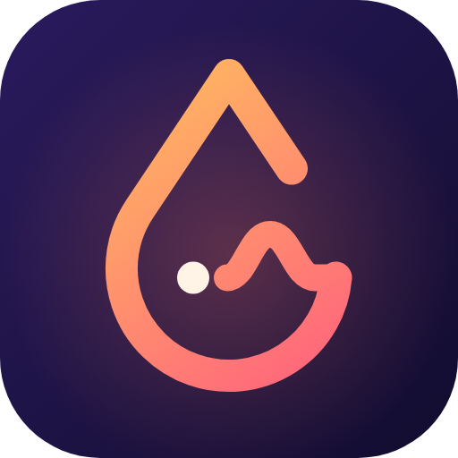

<p align="center"></p>

# Glykos

App Android personal que comunica la glucosa de un sensor CGM **mientras corres**, sin mirar ni
desbloquear el móvil:

- **Voz** en los cascos (TTS, bajando el volumen de la música mientras habla).
- **Muñeca**: notificaciones reenviadas al reloj Garmin a través de Garmin Connect.
- **Ambas**, según la configuración.

Ejemplos: voz "Ciento doce, bajando, menos ocho"; reloj `112 -8 baja (hace 1 min)`.

> ⚠️ **Aviso**: proyecto personal de uso propio. **No es un producto sanitario** y no sustituye a los
> sistemas de alarma oficiales del sensor ni al criterio médico. No recomienda tratamientos ni dosis.
> Mantén siempre activas las alarmas de la app oficial del sensor. Si la usas, lo haces bajo tu
> responsabilidad (ver [Licencia](#licencia)).

## Índice

1. [Cómo funciona](#cómo-funciona)
2. [Configurar la cuenta seguidora de LibreLinkUp](#1-configurar-la-cuenta-seguidora-de-librelinkup)
3. [Instalar y configurar la app en el móvil](#2-instalar-y-configurar-la-app-en-el-móvil)
4. [Configurar el reloj Garmin](#3-configurar-el-reloj-garmin)
5. [Comprobar que todo funciona](#4-comprobar-que-todo-funciona)
6. [Solución de problemas](#solución-de-problemas)
7. [Desarrollo](#desarrollo)

## Cómo funciona

```
Sensor CGM ──BLE──► App oficial del sensor ──► Nube LibreLinkUp
                                                   │ polling cada 60 s (cuenta seguidora)
                                                   ▼
                               App Glykos (foreground service)
                                ├─ AnnouncementPolicy      → cuándo avisar: intervalo, alarmas, dato obsoleto
                                ├─ VoiceOutput             → TTS por cascos
                                ├─ NotificationWatchOutput → notificación → Garmin Connect → reloj
                                └─ Sync (fase 2)           → Backend .NET 8 → Panel Angular
```

- Glykos **no lee el sensor directamente**: lee la nube de LibreLinkUp con una **cuenta seguidora**,
  igual que haría un familiar al que invitas a ver tus datos. La app oficial del sensor sigue siendo
  la que habla con el sensor y la que mantiene las alarmas oficiales.
- Comprueba la glucosa **cada 60 s** y habla **cada 5 min**, o **al momento** si hay una alarma:
  bajo (< 70), muy bajo (< 54), alto (> 180) o **sin datos** (sin conexión o lectura de más de 10 min).
- Los fallos son ruidosos: si no hay datos, la app lo dice en lugar de callar.

---

## 1. Configurar la cuenta seguidora de LibreLinkUp

Glykos necesita una **cuenta seguidora**: una cuenta de LibreLinkUp distinta a tu cuenta principal,
a la que invitas desde la app oficial del sensor para que pueda ver tus datos.

> 🔒 **Nunca uses tu cuenta principal** (la de la app del sensor) en Glykos. La API que usa Glykos no
> es oficial; si algo va mal, como mucho se bloquea la cuenta seguidora, no la que lee tu sensor.

### 1.1 Elegir un email para la cuenta seguidora

Necesitas un email **distinto** al de tu cuenta principal y al que tengas acceso, porque llegará una
invitación y un correo de verificación.

- Si usas Gmail, sirve un alias con `+`: si tu correo es `nombre@gmail.com`, usa
  `nombre+glykos@gmail.com`. Los correos llegan a la misma bandeja.
- También vale cualquier otro email tuyo.

### 1.2 Enviar la invitación desde la app oficial del sensor

En el móvil donde tienes la app oficial del sensor (la que lee el sensor):

1. Abre el **menú principal** (☰).
2. Entra en **Aplicaciones conectadas**.
3. Pulsa **LibreLinkUp** → **Conectar** / **Añadir conexión**.
4. Escribe un nombre (por ejemplo "Glykos") y el **email de la cuenta seguidora** del paso 1.1.
5. Envía la invitación.

> Los nombres exactos de los menús pueden variar un poco según la versión de la app.

### 1.3 Crear la cuenta seguidora y aceptar la invitación

1. Instala la app **LibreLinkUp** (Google Play o App Store). Puede ser en el mismo móvil o en otro.
2. Pulsa **Registrarse** y crea la cuenta **con el email del paso 1.1**. Elige una contraseña segura:
   esta cuenta puede ver tus datos de glucosa.
3. Verifica el email con el correo que te llegue.
4. Acepta los **términos de uso** y la **política de privacidad** cuando la app lo pida.
5. Acepta la **invitación** que aparece en la app (o en el correo de invitación).

### 1.4 Comprobarlo

Abre LibreLinkUp con la cuenta seguidora: **tienes que ver tu glucosa actual**. Si la ves, la cuenta
está lista para Glykos.

> ⚠️ Si alguna vez LibreLinkUp te pide aceptar unos **términos nuevos**, acéptalos en la app
> LibreLinkUp: mientras estén pendientes, Glykos no podrá iniciar sesión y dirá
> "Sin datos de glucosa, revisa la cuenta".

> ℹ️ Tras poner un **sensor nuevo** hay un periodo de calentamiento (unos 60 min en el Libre 2 Plus)
> sin lectura actual. Durante ese tiempo Glykos dirá "el sensor no envía datos": es lo esperado.

---

## 2. Instalar y configurar la app en el móvil

### 2.1 Instalar

- **Sin ser desarrollador**: Glykos no está publicada en Google Play para todo el mundo. Pídeme por
  privado que te añada como tester (necesito el email de la cuenta de Google de tu móvil) y sigue
  [docs/INSTALL.md](docs/INSTALL.md).
- **Desde el código** (ver [Desarrollo](#desarrollo)): `./gradlew installDebug` instala la versión de
  desarrollo como `com.glykos.app.debug`, que convive con la release.

### APK release

```bash
./gradlew :app:assembleRelease   # → app/build/outputs/apk/release/glykos-<versión>.apk
```

La firma se lee de `local.properties` (`release.storeFile`, `release.storePassword`,
`release.keyAlias`, `release.keyPassword`); el keystore vive **fuera del repo**. Guarda copia del
keystore y su contraseña: sin ellos no se pueden publicar actualizaciones que se instalen encima.

### 2.2 Configurar

Abre **Glykos** y, de arriba abajo:

1. **Cuenta LibreLinkUp (seguidora)**: escribe el email y la contraseña de la **cuenta seguidora**
   (paso 1) y pulsa **Guardar**. Se guardan **cifradas** (AES-256-GCM con una clave del Android
   Keystore) y no salen del móvil salvo para iniciar sesión en LibreLinkUp.
2. **Salida**: elige *Voz (cascos)*, *Reloj* o *Ambos*.
3. **Batería**: pulsa **Quitar optimización** y acepta. Sin esto, Android puede pausar Glykos con la
   pantalla apagada.
4. **Solo Xiaomi / Redmi / POCO**: pulsa **Abrir ajustes de la app** y:
   - *Ahorro de batería* → **Sin restricciones**.
   - Activa **Inicio automático**.

   Otros fabricantes con ajustes parecidos (Samsung, Huawei, OnePlus…): consulta
   [dontkillmyapp.com](https://dontkillmyapp.com).
5. Pulsa **Empezar** y concede los permisos:
   - **Notificaciones**: para la notificación fija y las del reloj.
   - **Actividad física**: Android 14+ lo exige para un servicio de tipo salud que funcione con la
     pantalla bloqueada. Glykos no lee ningún dato de actividad.

Aparecerá una notificación fija **"Glykos vigilando tu glucosa"** con un botón **Parar**.

---

## 3. Configurar el reloj Garmin

El Garmin Forerunner 35 no admite Connect IQ, así que la glucosa llega a la muñeca como
**notificación del móvil**.

1. En la app **Garmin Connect** del móvil: **Dispositivos** → tu reloj → **Notificaciones** →
   **Notificaciones de apps**.
2. Activa **Glykos**.
3. En el reloj, activa las notificaciones **durante la actividad** (en el FR35: ajustes →
   notificaciones → durante la actividad → mostrar).

Glykos usa dos canales de notificación, configurables en los ajustes de notificaciones de Android:

| Canal | Cuándo | Sonido |
| --- | --- | --- |
| Lecturas de glucosa | Cada aviso rutinario | Silencioso (ya habla la voz) |
| Alarmas de glucosa | Bajo, muy bajo, alto, sin datos | Sonido y vibración |

---

## 4. Comprobar que todo funciona

1. **Pruebas → Probar voz y reloj**: envía avisos de ejemplo a la voz, al reloj o a ambos, sin
   necesidad de cuenta. Con música sonando, la música debe bajar mientras habla.
2. Pulsa **Empezar**: la primera lectura se anuncia enseguida.
3. **Bloquea el móvil** con música y espera dos avisos (~10 min): debe seguir hablando y llegando al
   reloj.

---

## Solución de problemas

| Lo que dice Glykos | Causa probable | Qué hacer |
| --- | --- | --- |
| "Sin datos de glucosa, **revisa la cuenta**" | Email/contraseña incorrectos, términos pendientes en LibreLinkUp o falta aceptar la invitación | Revisa el paso 1. Tras un fallo de login, Glykos espera antes de reintentar (de 1 a 30 min) para no bloquear la cuenta |
| "Sin datos de glucosa, **el sensor no envía datos**" | Sensor calentando o caducado, o la app oficial no está subiendo datos | Comprueba que la app oficial muestra la glucosa y tiene internet |
| "Sin datos de glucosa, **sin conexión**" | El móvil de Glykos no tiene internet | Revisa datos móviles / Wi-Fi |
| "Sin datos de glucosa, **servicio saturado**" | LibreLinkUp ha limitado las peticiones (429) | Glykos espera lo que pida el servidor (5 min por defecto) |
| "**Sin datos recientes**. Último dato hace…" | La última lectura en la nube tiene más de 10 min | El móvil con la app oficial puede estar lejos del sensor o sin internet |
| No habla, pero la notificación llega | Sin voz en español o audio ocupado (llamada) | Instala la voz *Español (España)* en Ajustes → Texto a voz. El error aparece en la pantalla de Glykos |
| No llega nada al reloj | Glykos no está activado en Garmin Connect o el reloj no muestra notificaciones en actividad | Paso 3 |
| Se para con la pantalla apagada | Optimización de batería del fabricante | Paso 2.2, puntos 3 y 4 |

---

## Desarrollo

### Requisitos

- **JDK 17 o superior** para lanzar Gradle. Vale el que trae Android Studio
  (`export JAVA_HOME=/ruta/a/android-studio/jbr`). El código compila a Java 17; si no tienes ese JDK,
  Gradle lo descarga solo (foojay toolchain resolver).
- **Android SDK** (compileSdk 35, minSdk 26).
- Android Studio (recomendado). El wrapper de Gradle (9.9) ya está en el repositorio.

### Comandos

```bash
./gradlew assembleDebug   # compilar
./gradlew test            # tests unitarios
./gradlew lint            # lint
./gradlew installDebug    # instalar en el móvil conectado (depuración USB)
```

### Conectar el móvil

1. Activa las **opciones de desarrollador** (Ajustes → Información del teléfono → pulsar 7 veces en
   *Número de compilación* / *Versión de MIUI*).
2. Activa **Depuración USB**. En Xiaomi, activa también **Instalar vía USB**.
3. Conéctalo **directamente** al ordenador (algunos docks/hubs cortan adb) en modo
   *Transferencia de archivos* y acepta el aviso de depuración.
4. `adb devices` debe mostrar el móvil como `device`.

### Credenciales para tests en local

Los tests normales **no** necesitan credenciales (usan un servidor simulado). Para probar contra la
API real con la cuenta seguidora, crea `local.properties` en la raíz (está en `.gitignore`):

```properties
sdk.dir=/ruta/a/Android/Sdk

# Cuenta SEGUIDORA de LibreLinkUp (nunca la cuenta principal)
llu.email=tu-email-seguidor@ejemplo.com
llu.password=tu-contraseña
# Opcional: región inicial (por defecto api-eu.libreview.io; Glykos sigue la redirección de región)
# llu.host=api-eu.libreview.io
```

Y lanza el test real (opcional, hace un login de verdad: no abuses):

```bash
./gradlew :core:data:testDebugUnitTest -Pllu.live=true --tests '*LibreLinkUpLiveTest*'
# LIVE ✓ 131 mg/dl, STABLE, sensor time 2026-11-07T21:02:55Z, age 5.5s
```

Las credenciales de `local.properties` **solo** llegan al test que se ejecuta en el ordenador; nunca
se meten en el APK. En el móvil se configuran desde la app (paso 2.2).

### Módulos

| Módulo | Contenido |
| --- | --- |
| `:app` | Pantalla principal (Compose): cuenta, salida, batería, arrancar/parar, pruebas. |
| `:core:domain` | Kotlin puro, sin Android (compatible con KMP): modelos, `AnnouncementPolicy` (cuándo avisar), formateadores de voz y notificación, `GlucoseMonitor` (bucle lectura → decisión → salidas). |
| `:core:data` | `LibreLinkUpSource` (API no oficial), `SettingsRepository` (ajustes y credenciales cifradas), DI. |
| `:feature:monitor` | `MonitorService`: foreground service tipo `health`, wakelock, notificación fija. |
| `:feature:output` | `VoiceOutput` (TTS es-ES con ducking) y `NotificationWatchOutput` (notificación → Garmin). |
| `:feature:assistant` | Zonnia (fase 3+). |

### Stack

Kotlin 2.4, coroutines + Flow, Jetpack Compose, Hilt, Ktor client (OkHttp), kotlinx.serialization,
kotlinx-datetime, DataStore. Tests con JUnit 5, MockK y Turbine. Dependencias en
`gradle/libs.versions.toml`.

### API de LibreLinkUp

Flujo: `POST /llu/auth/login` (siguiendo la redirección de región) → `GET /llu/connections`
(`patientId`) → `GET /llu/connections/{patientId}/graph` en cada lectura. Cabeceras `product`,
`version`, `Authorization: Bearer` y `account-id` (SHA-256 del id de usuario), contrastadas con
[nightscout-librelink-up](https://github.com/timoschlueter/nightscout-librelink-up) y
[pylibrelinkup](https://github.com/robberwick/pylibrelinkup). Para proteger la cuenta: token
reutilizado, re-login solo ante 401, backoff de 1 a 30 min tras fallos de login y respeto de
`Retry-After` ante 429. Si deja de funcionar, lo primero es revisar `version` en
`LibreLinkUpConfig`.

## Nombres

| Nombre | Qué es |
| --- | --- |
| **Glykos** | La plataforma (app, web, futura suscripción). Del griego *glykós*, "dulce". |
| **Zonnia** | El asistente de voz y texto de Glykos (fase 3+). |
| **Glykos Run** | Modo para actividad física (el MVP actual). |

## Hoja de ruta

- **Fase 0 (spike)** ✅: login LibreLinkUp, lectura, voz con pantalla bloqueada, notificación al reloj.
  Validada en una tirada real de 76 min.
- **Fase 1 (MVP)**: configuración completa (intervalo, cambio mínimo, umbrales), histéresis en
  alarmas, sesión persistente, robustez.
- **Fase 2**: histórico local (Room), sync a backend .NET 8 en AWS, resumen de glucosa en Strava.
- **Fase 3**: panel Angular (tiempo en rango, comparativa por actividad, informe PDF) y Zonnia v1
  (push-to-talk con los cascos).
- **Fase 3.5+**: Zonnia v2 (preguntas sobre el histórico), predicción según esfuerzo.

## Limitaciones conocidas

- La API de LibreLinkUp **no es oficial** y puede cambiar sin aviso.
- Glykos depende de que la app oficial del sensor suba los datos a la nube: sin internet en ese móvil,
  no hay datos (Glykos lo avisa).
- El Garmin Forerunner 35 no admite Connect IQ: la única vía a la muñeca son las notificaciones.
- Algunos fabricantes de Android matan servicios en segundo plano aunque se excluya la app de la
  optimización de batería.
- El wakelock tiene un tope de seguridad de 6 h por sesión.

## Marcas

FreeStyle Libre, LibreLink y LibreLinkUp son marcas de Abbott. Garmin y Forerunner son marcas de
Garmin. Este proyecto no está afiliado, respaldado ni patrocinado por Abbott ni por Garmin.

## Licencia

[MIT](LICENSE). Puedes usar, modificar y redistribuir el código. Se ofrece **tal cual, sin garantía
de ningún tipo**. Si distribuyes una versión modificada a otras personas, tú eres responsable de ella
(en la UE, una app que avisa de valores de glucosa podría considerarse producto sanitario según el
MDR).
